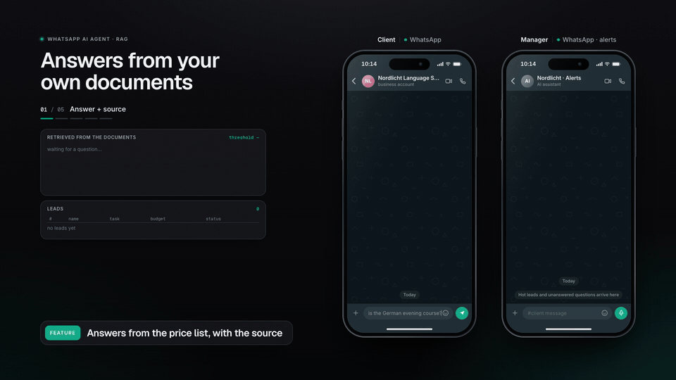
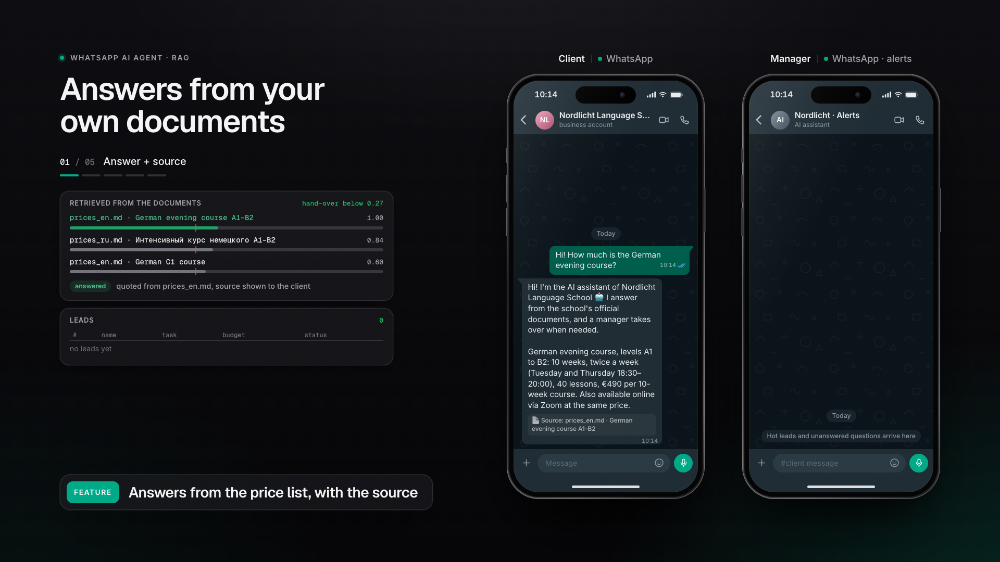
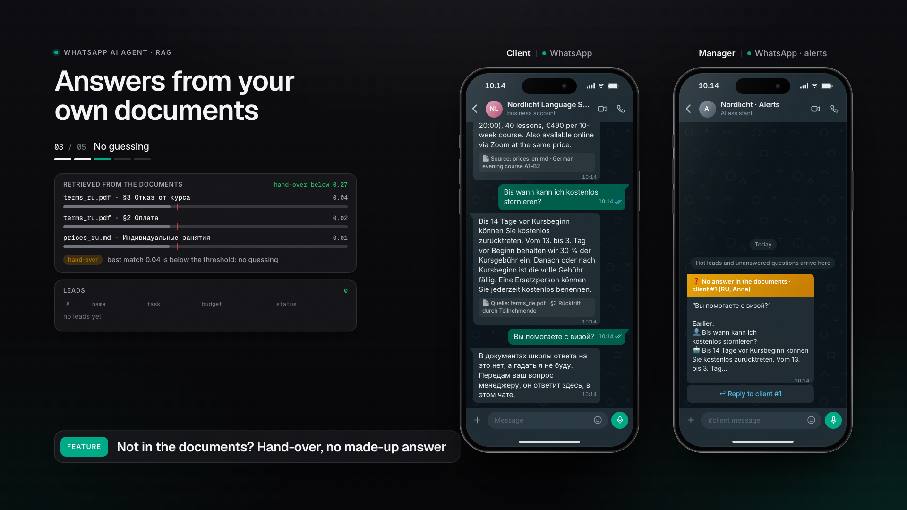
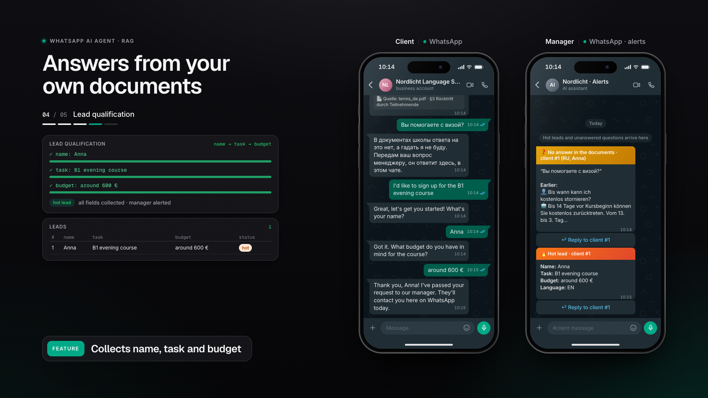
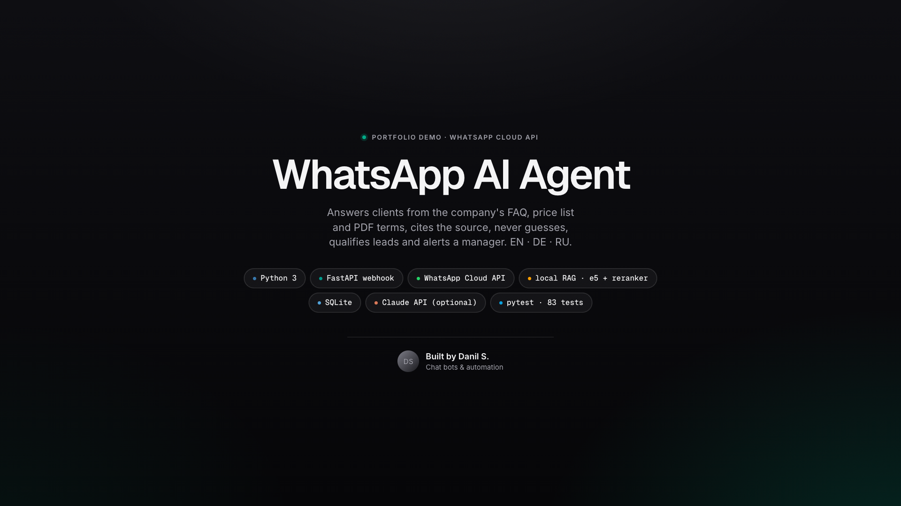

# WhatsApp AI Agent with RAG

A WhatsApp assistant for a small business that **answers clients from the company's own documents** (FAQ, price list, PDF terms and conditions), **cites the source**, **hands over to a manager instead of guessing**, and **qualifies leads** (name, task, budget). Python, FastAPI webhook for the official WhatsApp Cloud API, fully local and free retrieval, Claude API optional.

The demo company is a made-up language school in Hamburg, *Nordlicht Language School*.



▶️ **Full demo video (about 47 s, 1080p 60 fps):** [`demo.mp4`](demo.mp4)

| Answer + source | Honest hand-over |
|---|---|
|  |  |
| **Hot lead → manager** | **Summary** |
|  |  |

## Results

| Check | Result |
|---|---|
| 40-question set (30 answerable, 10 not in the documents), EN / DE / RU | **37/40 = 92.5 % correct** |
| Fabrications on the 10 out-of-scope questions | **0** (all 10 handed over to a manager) |
| Answers that quoted the wrong document | **0** (the 3 misses are safe hand-overs) |
| Extra stress set: 30 more out-of-scope questions, alone and right after an answered question | 0 false answers |
| pytest | 83 passed |

Full table: [`eval/RESULTS.md`](eval/RESULTS.md). Re-run: `.venv/bin/python eval/run_eval.py`. The numbers are for the free template mode (no API key).

## What it does
- **Answers from documents (RAG).** Markdown FAQ and price list, PDF terms read with `pypdf`. Every answer ends with the source, e.g. `📄 Source: prices_en.md · German evening course A1–B2`.
- **Never guesses.** If the best match is below the threshold, the client gets *"I couldn't find this in our documents, and I don't want to guess. I'll pass your question to a manager"*, and the manager gets the question with the last messages of the chat.
- **Lead qualification.** On buying intent ("I'd like to sign up", "Ich möchte mich anmelden", "Хочу записаться") the bot asks for the missing fields one at a time: name, task, budget. Questions in between are still answered from the documents, then it asks again. Budget ≥ `HOT_LEAD_MIN_BUDGET` = **hot lead**, pushed to the manager at once; otherwise saved as warm.
- **Manager in the loop.** Managers (`MANAGER_IDS`) get alerts on their own WhatsApp and reply through the bot: `#12 Hi Anna, your seat is reserved` goes to client #12. `/history 12` shows the dialog, `/leads` lists leads.
- **Dialog history** in SQLite: every client message, bot answer (with sources) and manager reply. Used for hand-over alerts, short follow-ups ("and online?") and as context for Claude.
- **EN / DE / RU.** Language detected per message; short replies ("Anna", "600 €") keep the conversation language. Documents exist in all three languages, so the quote is in the client's language. If a translation is missing, the bot quotes the original and says so.
- **EU AI Act, art. 50:** the first reply says *"I'm the AI assistant of …" / "Ich bin der KI-Assistent der …" / "Я ИИ-ассистент …"*.
- **Optional Claude answers.** With `ANTHROPIC_API_KEY` in `.env`, Claude (default `claude-opus-5-5`, low effort) phrases the reply in the client's language **from the retrieved sources only** and must answer `NO_ANSWER` if they don't cover the question. The retrieval threshold still runs first, so a weak match never reaches the model. If the API fails, the bot falls back to the quote.

## How retrieval works (local, free)
1. **Chunks.** Each FAQ question, price-list section and PDF clause (§1, §2, …) is one chunk. EN / DE / RU versions of the same section share a key.
2. **Candidates.** `intfloat/multilingual-e5-small` (118M params, CPU) embeds chunks once; vectors are cached in SQLite and recomputed only when a document changes. The 12 closest chunks go on.
3. **Re-scoring.** `cross-encoder/mmarco-mMiniLMv2-L12-H384-v1` (118M params, multilingual) scores each candidate as a whole and sentence by sentence. Its score (0..1) says "this text answers the question", which is what the hand-over threshold needs. Embedding similarity alone only says "same topic": with the best embeddings-only threshold the bot gets 85 % on the 40 questions with 1 fabrication (74 % on the dev set).
4. **Two fixes found by testing:** the cross-encoder was trained on web search, so "Where are **you** located?" is rewritten to "Where are **the school** located?" before scoring; and very short sentences ("Yes.") are glued to the next one, otherwise "Yes." matched every yes/no question.
5. **Fallback:** without `sentence-transformers` the bot uses BM25 keyword search (`rank-bm25`). It works, but on the same 40 questions it scores 65 % with 4 fabrications, so the default is the model pipeline.

**How the threshold was chosen.** On a separate dev set of 54 questions (not the 40 above) the hand-over threshold had a plateau without fabrications between logit −1.75 and −1.25. We took **−1.0 (score 0.27)**, a little above the plateau: a needless hand-over costs a manager one message, a made-up answer costs trust. On the dev set this costs one question (47/54 instead of 48/54). The 40-question set was used to compare models during development, so treat 92.5 % as an optimistic estimate; the stress set was added afterwards to catch over-fitting.

**Known limits.** The small reranker sometimes ranks a section by its title ("Can my employer pay for the course?" beats "payment methods" for *"Можно ли оплатить курс частями?"*, a dev-set question). Typical fixes for a client: more documents phrased the way customers ask, or Claude mode, which sees the top 4 sources instead of quoting one.

## Architecture
```
app/
  rag/loader.py        Markdown + PDF -> chunks with language-independent keys
  rag/index.py         e5 embeddings (SQLite cache) -> cross-encoder re-scoring; BM25 fallback
  rag/answer.py        TemplateAnswerer (quote + source) / ClaudeAnswerer (sources only, NO_ANSWER)
  core/agent.py        dialog: disclosure, RAG or hand-over, lead flow, manager commands
  core/leads.py        intent, name / task / budget extraction, hot / warm scoring
  core/lang.py         EN / DE / RU detection and all fixed texts
  core/db.py           SQLite: clients, messages (history), leads, hand-overs
  adapters/whatsapp.py Cloud API: webhook parse, X-Hub-Signature-256, 24 h window, templates
  adapters/emulator.py same WhatsApp payloads, kept in memory for the demo page
  main.py              FastAPI: /webhook/whatsapp, /api/emu/*, /api/history/{id}, /health
kb/                    the demo company's documents (FAQ, prices, terms PDF in EN / DE / RU)
eval/run_eval.py       accuracy on tests/data/*.jsonl, writes eval/RESULTS.md
demo/index.html        two-phone emulator (client + manager)
scripts/               make_terms_pdf.py (rebuild the PDFs), record_demo.py (video + screenshots)
tests/                 83 pytest tests, WhatsApp HTTP and Claude mocked
```
The WhatsApp adapter is the same one as in my booking bot: to add Telegram, Instagram or a website widget, write one adapter with `parse()`, `send()` and `verify_signature()`.

## Run locally (no accounts needed)
```bash
python3.12 -m venv .venv && .venv/bin/pip install -r requirements.txt
.venv/bin/python -m pytest -q                          # 83 passed (first run downloads about 1 GB of models)
.venv/bin/python eval/run_eval.py                      # 40 questions -> eval/RESULTS.md
.venv/bin/uvicorn app.main:app --host 127.0.0.1 --port 8092
open http://127.0.0.1:8092/demo/                       # emulator: client + manager phones
```
Use your own documents: put `.md` files (`## Question <!-- id: key -->` + answer) and PDFs (clauses starting with `§1`, `§2`, …) into `kb/`. Name language versions `*_en`, `*_de`, `*_ru`.

## Go live
1. Copy `.env.example` to `.env`, fill in the WhatsApp values and `MANAGER_IDS`, set `DEMO_MODE=0`. Add `ANTHROPIC_API_KEY` if you want Claude to phrase the answers.
2. Deploy behind HTTPS (EU hosting and a DPA / AV-Vertrag for EU clients). Both models run on CPU; the process peaked at 1.7 GB RAM in our test, so plan for 2–4 GB.
3. Meta App → WhatsApp → Configuration: webhook `https://<host>/webhook/whatsapp`, verify token = `WA_VERIFY_TOKEN`, subscribe to `messages`. Set `WA_APP_SECRET`: every POST is checked against `X-Hub-Signature-256`.
4. Create a **utility** template `manager_alert` with one body variable. Manager alerts are sent as normal messages while the manager's 24 h window is open and as this template when it is closed.

## Platform notes
- **Official WhatsApp Cloud API only** (`graph.facebook.com`). Unofficial clients (Baileys, whatsapp-web.js) break Meta's terms and get numbers banned.
- **Allowed use:** since 15 Jan 2026 WhatsApp bans general-purpose AI chatbots; an assistant that answers questions about one business's own services, like this one, is allowed. The bot stays inside the documents and refuses anything else.
- **Pricing:** Meta charges per delivered template message (since 1 July 2025). Replies inside the 24 h customer-service window are free up to 1,000 per number per month from 1 Oct 2026. Client questions are always answered inside the window.
- **Data:** chats are stored in SQLite on the client's server. The terms in the demo say chats are deleted after 90 days; add a cron job (`DELETE FROM messages WHERE ts < …`) to match your own policy.

## License
MIT, see [LICENSE](LICENSE). The company, people and documents in `kb/` are made up for the demo.
